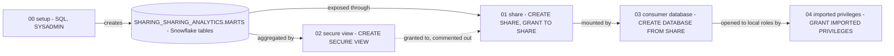

# Snowflake Data Sharing and Marketplace - Architecture and design rationale

*Last updated: 2026-11-07 · commit 2edefc322*

## 1. Purpose and scope

A learning tutorial on Snowflake secure data sharing: building a share as a provider, putting a secure view in front of
the data, mounting the share as a consumer and granting local roles access to it. The Snowflake Marketplace is covered
in prose in the tutorial only.

It is not a working two-account setup. The provider scripts (00 to 02) run in one account; the consumer scripts (03 and
04\) are commented out because they need a second account and a real share path. The README says to use two Snowflake
accounts, or a trial account with reader account capability. It does not say which was used (`TODO: verify`).

## 2. How this project was built

This project was built with Claude Code (Anthropic's AI coding assistant) in a complementary role. Elliott Fairhall is
the author and owner: the project is debugged, tested and used by him for learning and development, and the design
decisions below are explained so that they can be understood, questioned and learned from. AI assistance does not
replace that work. The repository does not record whether the consumer side was ever run against a second account, so
the document makes no claim about that.

## 3. Architecture at a glance

Solid arrows are what script 00 to 02 actually execute; scripts 03 and 04 are written as comments for a second account.
Nothing is copied: the consumer database reads the provider's storage (stated in the tutorial).

## 4. Learning path

| Order | Script                        | Teaches                                                                                      | Why here                                                                                         |
| ----- | ----------------------------- | -------------------------------------------------------------------------------------------- | ------------------------------------------------------------------------------------------------ |
| 00    | `00_setup_environment.sql`    | `SHARING_ANALYTICS.MARTS` with a customer dimension and an orders fact table                 | A provider needs something worth sharing; business-style tables make the later grants meaningful |
| 01    | `01_provider_share_setup.sql` | `CREATE SHARE`, `USAGE` on database and schema, `SELECT` on tables, adding consumer accounts | The share is the core object; everything else qualifies it                                       |
| 02    | `02_secure_sharing_views.sql` | A secure view aggregating revenue by segment                                                 | Sharing raw tables exposes every row; the view shows the governed alternative                    |
| 03    | `03_consumer_workflow.sql`    | `CREATE DATABASE ... FROM SHARE`, then querying it                                           | The other side of the exchange; placed after the provider side so there is something to mount    |
| 04    | `04_governance_grants.sql`    | `GRANT IMPORTED PRIVILEGES` to a local role                                                  | A mounted share is visible only to the role that created it until granted on                     |

The order follows the life of a share: create data, publish, restrict, consume, delegate. This sequence is the order of
the README's provider/consumer description; the argument that the view should be taught after the raw share is inferred
(section 10).

## 5. Isolation, idempotency and cleanup

- **Isolation:** namespaced (changed 2026-11-07). Script 00 uses `SHARING_ANALYTICS.MARTS` and `CREATE OR REPLACE TABLE`
  on `DIM_CUSTOMERS` and `FCT_ORDERS`. The `SHARING_` prefix stops them colliding with the same-named tables, with
  different columns, in the Data Masking and Materialised Views tutorials. A re-run replaces this tutorial's own tables.
- **Re-running:** script 01 uses `CREATE OR REPLACE SHARE`, which replaces a share of the same name; on a share that
  already has consumers that would be disruptive (`TODO: verify` how replacement affects existing consumers).
- **Cleanup:** none provided: no `DROP SHARE`, no database drop.
- **Cost:** negligible: four-row tables and no warehouse is named. Consumer-side reading is billed to the consumer's
  warehouse (`TODO: verify` against current Snowflake documentation).
- **Safety:** all rows are invented; the placeholder consumer account in script 01 is an example string in a comment.

## 6. Design rationale

### Teach the provider side as runnable code and the consumer side as commented code

- **Why:** a share can be built and inspected in one account, but mounting it needs a different account. Commenting out
  scripts 03 and 04 means the whole folder can be run without errors in a single account.
- **Gave up:** the learner never sees data arrive on the consumer side from the scripts alone, and the key lesson (the
  consumer queries live data in place) is told rather than shown.
- **Alternative not taken:** a reader account created by script. Reader accounts are mentioned in the README, but
  creating one adds cost and account-level privilege requirements.
- **Evidence:** the comments are in the code; the reason is inferred.

### Explain the secure view as the governance layer

- **Why:** the view returns revenue by segment, not named customers, so it shows how a provider can offer insight
  without exposing rows. It is `SECURE`, which the tutorial says hides the view definition and underlying data from
  consumers.
- **Gave up:** script 01 used to grant `SELECT` on both base tables directly to the share, which let a consumer read
  every customer name and revenue figure. That was fixed: script 01 now keeps the base-table grant only as a commented
  anti-pattern, and script 02 grants the secure view to the share, so the view is the only exposed object. The tutorial
  no longer shows a raw share first; the contrast is now a comment rather than a runnable step. Not run on Snowflake
  after the change.
- **Alternative not taken:** share base tables and teach the view as the fix. It would show the contrast but leaves a
  runnable over-share.
- **Evidence:** inferred from the code.

### Business-flavoured sample data in tutorial-prefixed names

- **Why:** a customer table and an orders table are familiar, and revenue by segment is a natural thing to share with a
  partner.
- **Gave up:** a real database named `SHARING_ANALYTICS` would be reused (section 5).
- **Alternative not taken:** a dedicated `DATA_SHARING_TUTORIAL_DB`, as used by the notebook-based tutorials in this
  portfolio.
- **Evidence:** inferred from the code.

### Describe the Marketplace in prose only

- **Why:** listings are created in the Snowsight interface (stated in the tutorial), not in SQL, and cannot be scripted
  in a file.
- **Gave up:** no hands-on Marketplace step. Statements about free, paid and private listings and about where providers
  manage them reflect the tutorial's date and are not verified here (`TODO: verify`).
- **Alternative not taken:** screenshots, which date quickly.
- **Evidence:** documented.

### Trade-offs against production practice

| Tutorial choice                            | Production practice                                             |
| ------------------------------------------ | --------------------------------------------------------------- |
| Direct grants on base tables (now removed) | Share curated secure views only; review what each grant exposes |
| `CREATE SHARE IF NOT EXISTS` (now used)    | Plus explicit `ALTER SHARE`, so consumers are never disturbed   |
| Tutorial-prefixed database names           | Dedicated, environment-named databases                          |
| One account, consumer steps commented      | Two accounts, tested end to end, including revocation           |
| Shared role `analyst` assumed to exist     | Roles created and documented as part of setup                   |

## 7. Quality and testing

No automated tests. The runnable scripts can be checked by running them and looking at the share with `SHOW SHARES`;
nothing in the repository records that being done or the consumer path being tested (`TODO: verify`). Whether `SYSADMIN`
holds the privilege to create a share is not established by the repository; creating shares may need a higher role
(`TODO: verify`).

## 8. Constraints, limitations and known gaps

- Scripts 03 and 04 are entirely commented out; no consumer behaviour is demonstrated.
- Script 04 references a role `analyst` that no script creates.
- Object names no longer collide with the Data Masking tutorial's tables (fixed 2026-11-07 by prefixing the database
  name).
- No cleanup and no teardown of the share.
- The README lists a `data/` folder of sample listing metadata that does not exist, and omits script 00 from its tree.
- The provider and consumer account identifiers in script comments are placeholders, not real accounts.

## 9. Running and extending

See the [README](../README.md) and the [tutorial](../Tutorial/DATA_SHARING_TUTORIAL.md). Before extending, move the
setup into a uniquely named database, add a teardown script (drop share, drop database) and decide whether the
base-table grants should stay. Change scripts 01 and 02 together, because the secure view's value depends on what script
01 exposes.

## 10. Rationale (confirmed by the owner)

Confirmed by Elliott Fairhall on 2026-11-07. This reasoning was first reconstructed from the code and commit history;
the owner has since agreed it is correct, so it is now the stated rationale rather than an inference.

- Consumer scripts were commented out because only one account was available when the scripts were extracted.
- The secure view was meant to be the shared surface. The direct base-table grants, which showed the basic mechanism
  first, were an over-share and have been replaced by a commented anti-pattern.
- `ANALYTICS` was originally reused as a name so the data looked like a normal mart, without anticipating the collision
  with the masking tutorial. The database is now `SHARING_ANALYTICS` (changed 2026-11-07).
- The Marketplace is prose-only because listings are managed through the web interface.
- The scripts were run on a personal or trial-style account (confirmed by the owner).
